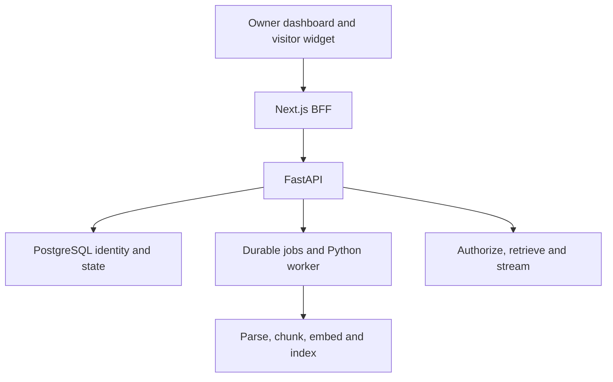

# Technical requirements and architecture

## Runtime boundaries

Next.js serves the owner dashboard, Auth.js session transport, widget assets and a same-origin BFF. FastAPI owns domain logic, canonical identity, authorization, storage access, ingestion, retrieval and streaming. A separate Python worker runs ingestion jobs. PostgreSQL is the durable source of truth. Redis accelerates rate limiting, semantic caching and job notifications. Pinecone stores embeddings. Existing VPS disk stores private original files and temporary processing artifacts.

External adapters are described separately to keep the diagram readable. Ingest reads private storage, calls Cloudflare embeddings and upserts Pinecone. Chat checks Redis, embeds the query through the same embedding adapter, retrieves Pinecone candidates, validates them against PostgreSQL, and calls the configured free LLM.

## Identity and Auth.js integration

FastAPI owns users, password hashes, OAuth links, verification tokens and sessions. Passwords use Argon2id. Verification/reset tokens are random, single-use, short-lived and stored as hashes. Password reset revokes prior sessions. Require recent reauthentication for sensitive settings.

Auth.js handles Next.js cookies and OAuth navigation, not duplicate user storage. Credentials authorize calls FastAPI login. The Google callback exchanges its ID token with FastAPI, which validates it independently against the configured Google client ID. FastAPI returns an opaque random backend session token. Store only its hash in PostgreSQL.

Keep that backend token inside Auth.js's encrypted, HTTP-only JWT cookie. Do not expose it through the client session object. Next server routes decode the cookie with the supported helper for the pinned Auth.js release and forward the opaque token to FastAPI. FastAPI checks revocation, expiry, verified identity and company membership on every protected request. Validate this bridge with a small integration spike on day 1. Use seven-day maximum sessions initially, with no refresh-token subsystem. Auth.js cookie lifetime cannot exceed backend token lifetime.

Google account collisions require authenticated explicit linking. Never enable unsafe email-only linking. Cookie mutations need CSRF and Origin protection. Visitor sessions are separate random, short-lived bot-scoped tokens, never owner tokens.

## Ingestion execution

1. Authenticate owner and check file/source/storage budgets.
2. Create a document and upload intent. Stream upload into a private temporary file, validate size/type, then atomically finalize storage. The local-storage adapter replaces the current S3-only dependency. S3 remains an optional future adapter.
3. In one PostgreSQL transaction create the source version and durable ingestion job. Notify Redis after commit. Return HTTP 202 with job ID.
4. Worker claims a due job under a lease, downloads/reads the approved object, validates it, extracts structured text, and persists a content checksum and extraction checkpoint.
5. Parse PDF per page, DOCX paragraphs and tables, HTML main content, and plain text headings. Normalize without dropping page references. Reject empty/scanned content with a useful error.
6. Split paragraphs/headings first, then tokenizer-aware windows with a starting target of 350 tokens and 50-token overlap. Enforce a conservative 512-token maximum until real model input tests validate another bound. Use a tokenizer compatible with BGE-M3, not character-count assumptions. Preserve heading, page, source and offsets.
7. Batch Cloudflare embeddings. Validate response count, finite values and expected dimensions. Start at expected dimension 1024 and confirm against a real response before creating a new index. Store checkpointed batch artifacts privately with TTL.
8. Upsert deterministic IDs containing company, document, version and chunk number. Metadata includes bot/source scope, version, page and checksum. Persist a chunk manifest and reconcile expected counts.
9. Mark the version ready only after indexing readiness is verified. Publication determines whether that ready version is visible to visitors. Worker updates PostgreSQL status. Pinecone does not write SQL status.

## Durable queues, retries and crashes

Implement one Python job runner over PostgreSQL `jobs`, with queue kinds `main`, `retry` and `dead`. These are logical durable queues. Redis contains wake-up/due-job hints only. Do not introduce a Node/BullMQ worker into this Python backend.

Use transactional job creation, atomic claims, lease expiry, heartbeat and attempt fencing. A worker finishing with a stale lease token cannot publish status. Default maximum four total execution attempts, with jittered backoff around 5 seconds, 30 seconds and 2 minutes for transient failures. Retry only failed/uncommitted work using validated checkpoints. Invalid input is permanently failed. Provider quota exhaustion enters `quota_wait` with a next eligible time and does not burn all retries. Exhausted jobs enter dead state and mark the source version failed with a safe error code.

Redis notification failure never rolls back a committed source. A recovery sweep reconciles missing notifications and expired leases. Begin with a 15-minute idle reconciliation interval and adaptive Redis polling, measure cloud command/CU use, and wake immediately on local enqueue. Do not constantly poll a sleeping cloud PostgreSQL instance. Manual replay creates a new attempt generation, validates current source version, and remains idempotent. Delete/unpublish invalidates in-flight work before cleanup.

## Query execution and semantic cache

Authenticate visitor bot session or owner session → validate published/draft scope → apply rate and global quota checks → store user message and assistant pending record → embed query → optional tenant-scoped Redis semantic lookup → retrieve Pinecone on miss → validate candidate source IDs/versions/readiness against PostgreSQL → construct grounded prompt → stream free LLM response → persist final result and usage → optionally cache approved complete result.

Semantic lookup receives the query vector plus company, bot, publication version, language, prompt version and authorization scope. It returns an approved answer, citations and similarity, or a miss. Never reuse contextual follow-up answers across unrelated conversations. Begin with cache disabled for multi-turn/personalized questions. Thresholds require an evaluation set. Validate citations against live scope even on a cache hit. Missing/revoked sources invalidate reuse immediately.

LangGraph input is a typed state containing authorized company/bot IDs, publication snapshot, question, bounded authorized history, query vector and retrieval settings. Nodes perform retrieval, evidence filtering, prompt creation and generation. Output is answer events and final answer, authorized citation objects, usage, status and safe error code. LangGraph is the orchestrator and does not replace Pinecone search. Retrieved content is text plus metadata, not raw vectors inserted into the LLM prompt.

Only trusted platform instructions define boundaries. Owner instructions and extracted documents cannot grant permissions. V1 chat has no tool capable of changing accounts or deleting data. Do not use a keyword classifier as authorization.

## Streaming and failure semantics

Use POST with fetch-readable SSE, not browser EventSource requiring GET. Proxy SSE without buffering. Events are `meta`, `delta`, `sources`, `done` and `error`, with request/message IDs and ordered sequence numbers. Abort propagates through BFF and FastAPI to the provider. Heartbeats keep connections alive. Once streaming begins, errors travel as SSE events, not an attempted new HTTP status. Persist `interrupted` if disconnected or cancelled. Retry starts a new message generation ID, never silently appends duplicate text.

Validate retrieval and secret-access policies before generation. If output moderation is required, buffer a complete moderation unit before releasing it. Already streamed text cannot be retracted. Regex guardrails cannot guarantee confidentiality or safety. Content requiring strict whole-response review must use buffered responses.

## Lifecycle and isolation

Apply company/bot scope in SQL and Pinecone namespaces and metadata. Validate conversation owner or visitor identity, not company ID alone. A publication references immutable source versions. Source deletion revokes access in PostgreSQL immediately and queues physical object/vector deletion. Version replacement publishes atomically and cleans old versions only after no publication references them. Cache invalidation uses publication version and live scope checks.

URL import resolves and validates each target and redirect, blocks private/link-local/loopback/metadata networks including IPv6 and DNS rebinding, restricts ports and protocols, caps response bytes/time/pages and strips scripts. Use a controlled HTTP client. No authenticated crawling or arbitrary headless browser execution in V1.
