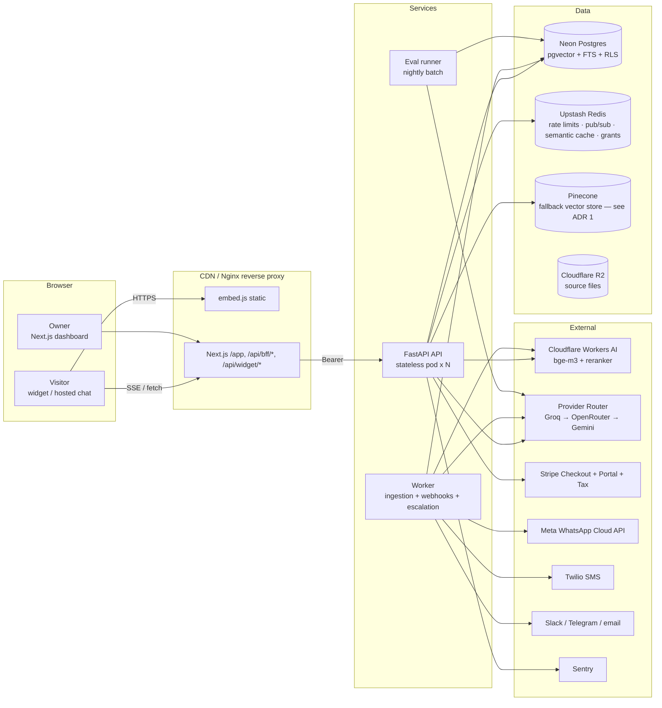
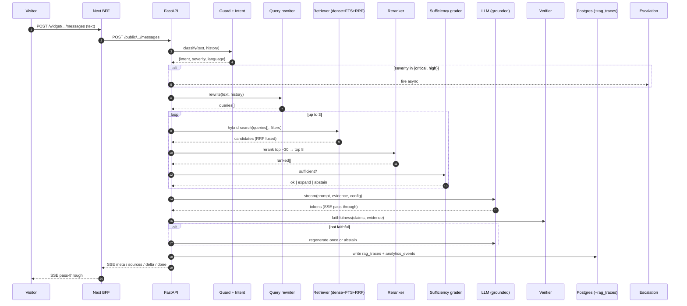
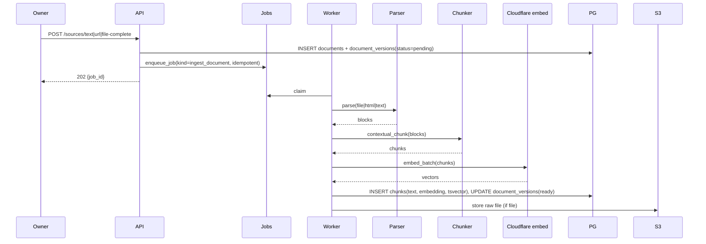
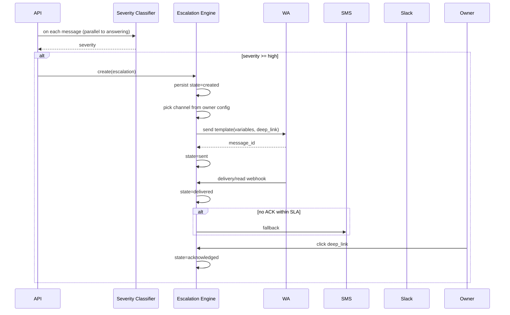

# 04 · Target architecture

One picture, four flows, nine decisions. Each ADR is a separate file under `launch/adr/`.

## Topology (production target, US-east)

Three guarantees the topology encodes:
- **Stateless API pods**: everything mutable lives in Postgres or Redis. We can run 1 or 5 pods identically.
- **One durable queue**: ingestion, webhooks, escalation, re-crawl all use `jobs` + `job_attempts`. No Celery, no SQS.
- **One identity surface**: BFF → Bearer → backend. Visitor Bearer and owner Bearer are different scopes; backend accepts both but routes them to disjoint handlers.

## Chat data flow (RAG v2)

Latency budget: guard ≤ 60 ms · rewrite ≤ 400 ms · retrieve ≤ 200 ms · rerank ≤ 350 ms · grade ≤ 250 ms · TTFT p50 ≤ 2 s on free Groq.

## Ingestion flow

## Escalation flow

## Deployment

- Target host: owner's existing VPS, 4 vCPU / 8 GB.
- Docker Compose: `api`, `worker`, `nginx` (TLS + SSE buffering off), optional `node_exporter`.
- CDN: Cloudflare in front of `app.knowmivo.com` (dashboard + widget iframe + embed.js).
- DNS layout: `app.knowmivo.com` (Next.js), `api.knowmivo.com` (FastAPI, ingress through same Nginx), `cdn.knowmivo.com` (Cloudflare pages mirror for `embed.js`, optional).
- Email: Postmark or Resend (reputation-safe, cheap). SPF/DKIM/DMARC at DNS.
- Secrets: single `.env` per env (`.env.staging`, `.env.production`); loaded by systemd `EnvironmentFile=` or docker-compose `env_file`.
- Health probes: `/api/v1/health/ready` for the API + `/api/health` for the frontend.

## Observability

- **Logs**: JSON to stdout → Loki (if the VPS runs it) or Cloudflare Logpush. Fields: `ts`, `level`, `msg`, `request_id`, `company_id`, `conversation_id`, `user_id`, `path`.
- **Traces**: `sentry-sdk[fastapi]` (free tier) + OTel SDK optional, 10 % sample on chat.
- **Metrics**: `/metrics` Prometheus endpoint from `prometheus-fastapi-instrumentator`.
- **Alerts**: Sentry → Slack; UptimeRobot for /health.
- **SLOs**: availability 99.5 % monthly · chat TTFT p50 ≤ 2 s · ingest ready p95 ≤ 180 s per MB.

## Nine architecture decisions (full ADRs linked)

| ADR | Topic | Decision | File |
| --- | --- | --- | --- |
| 001 | Vector store | **pgvector + FTS in Postgres** (Pinecone becomes a compat shim, deprecated after Day 3) | `adr/001-vector-store.md` |
| 002 | Tenant isolation | **App filter + Postgres RLS + fail-closed regression** | `adr/002-rls.md` |
| 003 | Async / queueing | Keep existing `jobs` runner; add outbox pattern on event emit | `adr/003-queue-outbox.md` |
| 004 | LLM provider router | Interface + Groq primary + OpenRouter fallback + per-tenant RL + semantic cache | `adr/004-provider-router.md` |
| 005 | Realtime | **SSE + Redis pub/sub** for inbox (WebSocket only if P1 blocker emerges) | `adr/005-realtime.md` |
| 006 | Widget delivery | Loader + iframe (keep) + versioned CDN URL + strict postMessage schema | `adr/006-widget-delivery.md` |
| 007 | API versioning | Lock `/api/v1`, generate OpenAPI → TS client in CI, RFC 9457 problem-details | `adr/007-api-conventions.md` |
| 008 | Billing | Stripe as source of truth, our DB as cache; Stripe Tax on, reconciliation cron | `adr/008-billing.md` |
| 009 | Data retention | `retention_days` per plan + nightly hard-delete worker + export pre-delete | `adr/009-data-lifecycle.md` |

Everything else in section 6 of the master prompt folds into one of these nine. Config/secrets/flags (12) live inside 004+008+009; deployment (12) is captured in the topology above; frontend architecture (13) is in `08-UX-SPEC.md`.
